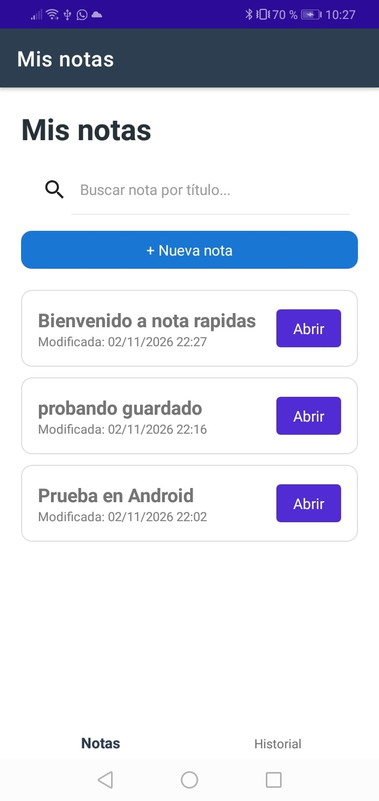
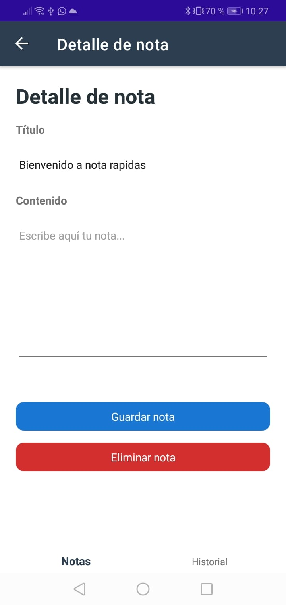

# Notas Rápidas SQLite

Aplicación móvil desarrollada con **.NET MAUI y SQLite** como parte de la Tarea 6 del Grupo N°3 de PDM II, del III Periodo 2026.

## Descripción

Notas Rápidas es una aplicación que permite crear, consultar, editar y eliminar notas, almacenando la información localmente mediante una base de datos SQLite.

También incorpora un historial de actividades para registrar las operaciones realizadas por el usuario.

## Tecnologías utilizadas

- C#
- .NET 10 MAUI
- SQLite
- sqlite-net-pcl
- SQLitePCLRaw.bundle_green
- CommunityToolkit.Mvvm
- Visual Studio 2026

## Funcionalidades

- Crear notas.
- Consultar listado de notas.
- Editar notas existentes.
- Eliminar notas con confirmación.
- Validar que el título sea obligatorio.
- Limitar el título a 100 caracteres.
- Consultar el historial de actividades.
- Buscar notas por título mediante SearchBar.
- Guardar información localmente con SQLite.

## Estructura del proyecto

```text
NotasRapidasSQLite/
│
├── Models/
│   ├── Nota.cs
│   └── Historial.cs
│
├── Services/
│   └── NotasDatabase.cs
│
├── ViewModels/
│   ├── NotasViewModel.cs
│   ├── HistorialViewModel.cs
│   └── DetalleNotaViewModel.cs
│
├── Views/
│   ├── NotasPage.xaml
│   ├── HistorialPage.xaml
│   └── DetalleNotaPage.xaml
│
├── Capturas/
│   ├── 01-Notas.png
│   ├── 02-Detalle.png
│   └── 03-Historial.png
│
├── App.xaml
├── AppShell.xaml
├── MauiProgram.cs
└── README.md
```

## Capturas de pantalla

### 1. Listado de notas



### 2. Detalle de una nota



### 3. Historial de actividades

![Historial](Capturas/03